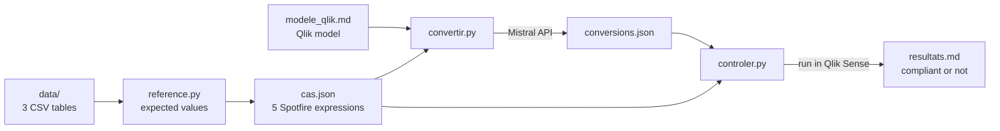
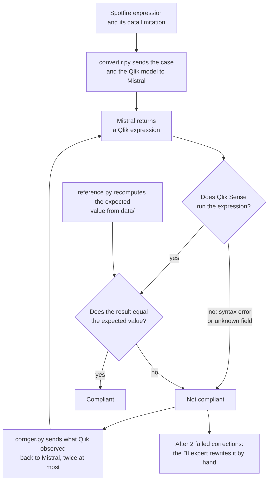

<p align="center">
  
</p>

<h1 align="center">Mistral AI: converting Spotfire expressions<br />to Qlik Sense expressions</h1>

<p align="center">
  A small Python proof of concept: the Mistral API rewrites 5 expressions from a Spotfire dashboard for Qlik Sense,
  then each answer is run in Qlik and compared with a value recomputed from the data.
</p>

<p align="center">
  <a href="README.md"></a>&nbsp;<a href="README.en.md"></a>
</p>

<p align="center">
  <a href="LICENSE"></a>
  
  
  
  
</p>

<p align="center">
  <a href="#quick-start"><b>Quick start</b></a>
  &nbsp;·&nbsp; <a href="#architecture">Architecture</a>
  &nbsp;·&nbsp; <a href="#flowchart">Flowchart</a>
  &nbsp;·&nbsp; <a href="#results">Results</a>
  &nbsp;·&nbsp; <a href="#limitations">Limitations</a>
</p>

## Quick start

Prerequisite: Python 3.12. The baseline runs without any key or account.

```powershell
git clone https://github.com/cnanaj-wq/mistral-ai.git
cd mistral-ai
python reference.py
```

Expected result: 5 `OK` lines, then `Les 5 valeurs attendues se retrouvent dans data/.` ("the 5 expected values are found in data/").

Running the conversion requires a Mistral API key:

```powershell
$env:MISTRAL_API_KEY = "your key"
python convertir.py
```

Checking the answers requires the `qlik` command-line tool, connected to a Qlik Sense Cloud tenant where the data is loaded:

```powershell
python controler.py <Qlik application id>
```

## Choose your next step

| You want to… | Go here |
|---|---|
| See the 5 expressions and their expected values | [`cas.json`](cas.json) |
| Read the context Mistral receives | [`modele_qlik.md`](modele_qlik.md) |
| Read the API call | [`convertir.py`](convertir.py) |
| Understand how an answer is judged | [`controler.py`](controler.py) |
| See how the Qlik error is sent back to Mistral | [`corriger.py`](corriger.py) |
| Check the expected values without Qlik or Mistral | [`reference.py`](reference.py) |

## Why this project

Migrating a dashboard from Spotfire to Qlik Sense means rewriting every expression: the two tools do not filter data the same way. By hand, it is long and repetitive.

The question asked here: can a language model do this rewriting, and can it be verified without taking its word for it? The answer is measured. A converted expression is only accepted if, once run in Qlik Sense, it returns the expected number.

The data belongs to a fictional company, Orvane Distribution, taken from the [migration-spotfire-qlik-sense](https://github.com/cnanaj-wq/migration-spotfire-qlik-sense) repository.

## What is inside

| Item | Count | Where |
|---|---|---|
| Spotfire expressions to convert | 5 | [`cas.json`](cas.json) |
| Data tables (CSV) | 3 | [`data/`](data/) |
| Data rows | 10,352 | [`data/`](data/) |
| Python scripts | 4 | [`convertir.py`](convertir.py), [`controler.py`](controler.py), [`corriger.py`](corriger.py), [`reference.py`](reference.py) |
| Dependencies needed to call the API | 0 | Python standard library |

The five cases:

| Case | Spotfire expression | What makes the conversion less simple |
|---|---|---|
| Year-to-date revenue | `Sum([CA Réel])` | the data limitation has to move into the expression |
| Margin rate | `100 * Sum([Marge brute Réel]) / Sum([CA Réel])` | two aggregations to limit |
| Revenue gap to budget | `100 * (Sum([CA Réel]) / Sum([CA Budget]) - 1)` | two aggregations, parentheses |
| EBITDA | `Sum([Réel])` | fields renamed in Qlik, `<=` comparison |
| Margin effects | `Sum([Montant]) / 1000` | renamed fields, condition on a text value |

The column names, the scripts and the prompt are in French.

## Architecture



Four scripts, four roles: `reference.py` computes what must be obtained, `convertir.py` queries Mistral, `controler.py` runs the answer in Qlik Sense and decides, `corriger.py` sends back to Mistral what Qlik observed.

## Flowchart

The path of one expression, from Spotfire to the verdict:



## Results

Run of 26 November 2026, model `mistral-medium-latest`, a single request per expression, no correction.

| Case | Expected value | Manual migration | Mistral conversion |
|---|---|---|---|
| Year-to-date revenue | 74,215,646.71 | compliant | not compliant |
| Margin rate | 29.4514 % | compliant | not compliant |
| Revenue gap to budget | +1.0753 % | compliant | not compliant |
| EBITDA | 5,311,850.59 | compliant | not compliant |
| Margin effects | −1,072.4964 k€ | compliant | compliant |
| **Total** | | **5 out of 5** | **1 out of 5** |

The four failures share one cause, a Qlik Sense syntax rule. Mistral wrote:

```
Sum({<[Exercice]={2026}, [Mois]={<=10}>} [CA Réel])
```

In set analysis, a comparison is a search and must be written in double quotes: `[Mois]={"<=10"}`. Without them, Qlik Sense returns no value.

What Mistral got right in all five cases: moving the Spotfire limitation into the expression, and finding the renamed fields (`[CR Réel]`, `[Ordre rubrique]`, `[Type de poste]`, `[Écart de marge]`). The only compliant case is the one with no comparison.

What the run shows: the conversion looks like valid Qlik and reads well, but four times out of five it computes nothing. Without running it in Qlik Sense, the error would have gone unnoticed. Raw answers are in [`conversions.json`](conversions.json), the detailed check in [`resultats.md`](resultats.md).

### Second run: Mistral receives what Qlik Sense observed

[`corriger.py`](corriger.py) runs each expression in Qlik Sense. If it is not compliant, Mistral receives its own answer and what Qlik replied, without the expected value or any hint about the cause. At most two corrections per case.

| Case | First run | After Qlik Sense feedback | Requests to Mistral |
|---|---|---|---|
| Year-to-date revenue | not compliant | compliant | 2 |
| Margin rate | not compliant | compliant | 3 |
| Revenue gap to budget | not compliant | compliant | 2 |
| EBITDA | not compliant | compliant | 3 |
| Margin effects | compliant | compliant | 1 |
| **Total** | **1 out of 5** | **5 out of 5** | **11** |

Mistral did not find the double-quote rule. It worked around it by listing the values one by one:

```
Sum({<[Exercice]={2026}, [Mois]={1,2,3,4,5,6,7,8,9,10}>} [CA Réel])
```

The number is right, the wording is heavier than the manual migration (`[Mois clos]={1}`), and it will need a manual edit when one more month is closed. Two cases needed two corrections: the first attempt added spaces or wrote `{1..10}`, which Qlik Sense also rejects.

### Attempt 1, then attempt 2: what Mistral wrote and what Qlik replied

Each row is an answer from Mistral, exactly as returned, followed by what Qlik Sense made of it. The message sent back to Mistral after a failure is always the same: "I ran your expression in Qlik Sense: Qlik Sense replies: Qlik returns no value (invalid expression). Fix the expression and answer in the same JSON format." (sent in French, translated here)

**EBITDA**

Spotfire : `Sum([Réel])`, limited by `[Exercice] = 2026 and [Mois] <= 10 and [Ordre] <= 7`

| Attempt | Mistral's answer | Qlik Sense feedback |
|---|---|---|
| 1 | `Sum({<[Exercice]={2026}, [Mois]={<=10}, [Ordre rubrique]={<=7}>} [CR Réel])` | no value returned |
| 2 | `Sum({<[Exercice]={2026}, [Mois]={1..10}, [Ordre rubrique]={1..7}>} [CR Réel])` | no value returned |
| 3 | `Sum({<[Exercice]={2026}, [Mois]={1,2,3,4,5,6,7,8,9,10}, [Ordre rubrique]={1,2,3,4,5,6,7}>} [CR Réel])` | compliant: 5311850.5900 |

<details>
<summary>See the other four cases</summary>

**Year-to-date revenue**

Spotfire : `Sum([CA Réel])`, limited by `[Exercice] = 2026 and [Mois] <= 10`

| Attempt | Mistral's answer | Qlik Sense feedback |
|---|---|---|
| 1 | `Sum({<[Exercice]={2026}, [Mois]={<=10}>} [CA Réel])` | no value returned |
| 2 | `Sum({<[Exercice]={2026}, [Mois]={1,2,3,4,5,6,7,8,9,10}>} [CA Réel])` | compliant: 74215646.7100 |

**Margin rate**

Spotfire : `100 * Sum([Marge brute Réel]) / Sum([CA Réel])`, limited by `[Exercice] = 2026 and [Mois] <= 10`

| Attempt | Mistral's answer | Qlik Sense feedback |
|---|---|---|
| 1 | `100 * Sum({<[Exercice]={2026}, [Mois]={<=10}>} [Marge brute Réel]) / Sum({<[Exercice]={2026}, [Mois]={<=10}>} [CA Réel])` | no value returned |
| 2 | `100 * Sum({<[Exercice] = {2026}, [Mois] = {<=10}>} [Marge brute Réel]) / Sum({<[Exercice] = {2026}, [Mois] = {<=10}>} [CA Réel])` | no value returned |
| 3 | `100 * Sum({<[Exercice]={2026}, [Mois]={1,2,3,4,5,6,7,8,9,10}>} [Marge brute Réel]) / Sum({<[Exercice]={2026}, [Mois]={1,2,3,4,5,6,7,8,9,10}>} [CA Réel])` | compliant: 29.4514 |

**Revenue gap to budget**

Spotfire : `100 * (Sum([CA Réel]) / Sum([CA Budget]) - 1)`, limited by `[Exercice] = 2026 and [Mois] <= 10`

| Attempt | Mistral's answer | Qlik Sense feedback |
|---|---|---|
| 1 | `100 * (Sum({<[Exercice]={2026}, [Mois]={<=10}>} [CA Réel]) / Sum({<[Exercice]={2026}, [Mois]={<=10}>} [CA Budget]) - 1)` | no value returned |
| 2 | `100 * (Sum({<[Exercice]={2026}, [Mois]={1,2,3,4,5,6,7,8,9,10}>} [CA Réel]) / Sum({<[Exercice]={2026}, [Mois]={1,2,3,4,5,6,7,8,9,10}>} [CA Budget]) - 1)` | compliant: 1.0753 |

**Margin effects**

Spotfire : `Sum([Montant]) / 1000`, limited by `[Exercice] = 2026 and [Type] = "Effet"`

| Attempt | Mistral's answer | Qlik Sense feedback |
|---|---|---|
| 1 | `Sum({<[Exercice]={2026}, [Type de poste]={'Effet'}>} [Écart de marge]) / 1000` | compliant: -1072.4964 |

</details>

What the second run shows: it is the "convert, run, correct" loop that moves the score from 1 to 5 out of 5, not the conversion alone. The successive attempts are in [`corrections.json`](corrections.json).

## Repository map

```
cas.json            the 5 Spotfire expressions, their limitation and the expected value
modele_qlik.md      the description of the Qlik model given to Mistral
convertir.py        calls the Mistral API, writes conversions.json
controler.py        runs the expressions in Qlik Sense, writes resultats.md
corriger.py         sends what Qlik observed back to Mistral, writes corrections.json
reference.py        recomputes the expected values from data/
data/               3 CSV tables from the fictional dataset
img/                banner and its script
```

## Limitations

- **One pass, one model.** Each run was launched once, with `mistral-medium-latest`. The result says nothing about another model or a more precise prompt.
- **The loop needs an expected value.** It stops when the number is right. On a real dashboard, that number has to exist first, read in Spotfire or recomputed from the data.
- **Five expressions, not a tool.** The set is too small to conclude anything about a whole dashboard.
- **The Qlik model is provided.** Mistral receives the list of renamed fields. Without it, it cannot guess that `[Réel]` became `[CR Réel]`.
- **A correct number does not prove everything.** The check runs with no selection. An expression can return the right total and still react badly when the user filters a region or a month.
- **An answer can change.** Temperature is set to 0, but a model name such as `mistral-medium-latest` points to a model that evolves. `conversions.json` keeps the name of the model that answered.
- **The check requires Qlik Sense Cloud.** Without a tenant, only `reference.py` can be run.

## What is sent to Mistral

For each case: the Spotfire table name, the data limitation, the expression and the description of the Qlik model. No data row is sent. The key stays in an environment variable: it is not written to any file.

## Contributing · Security · License

[Contributing](CONTRIBUTING.md) · [Security](SECURITY.md) · [MIT](LICENSE) license

## Author

**Cédric NANA** · BI & Data consultant · [GitHub](https://github.com/cnanaj-wq)
