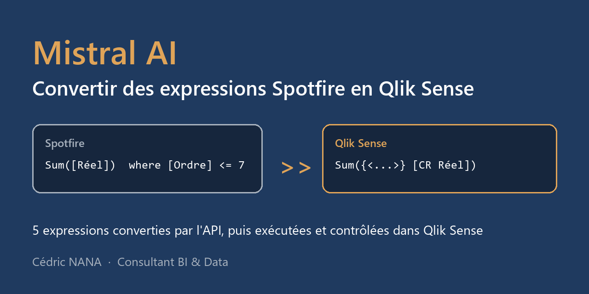
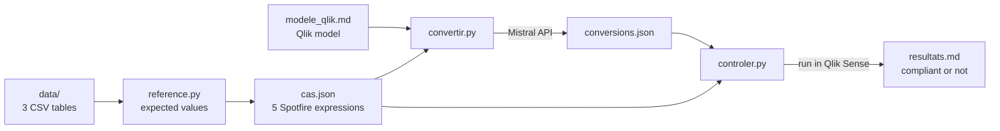

<p align="center">
  
</p>

<h1 align="center">Mistral AI: converting Spotfire expressions<br />to Qlik Sense expressions</h1>

<p align="center">
  A small Python proof of concept: the Mistral API rewrites 5 expressions from a Spotfire dashboard for Qlik Sense,
  then each answer is run in Qlik and compared with a value recomputed from the data.
</p>

<p align="center">
  <a href="README.md"></a>&nbsp;<a href="README.en.md"></a>
</p>

<p align="center">
  <a href="LICENSE"></a>
  
  
  
  
</p>

<p align="center">
  <a href="#quick-start"><b>Quick start</b></a>
  &nbsp;·&nbsp; <a href="#architecture">Architecture</a>
  &nbsp;·&nbsp; <a href="#results">Results</a>
  &nbsp;·&nbsp; <a href="#limitations">Limitations</a>
</p>

## Quick start

Prerequisite: Python 3.12. The baseline runs without any key or account.

```powershell
git clone https://github.com/cnanaj-wq/mistral-ai.git
cd mistral-ai
python reference.py
```

Expected result: 5 `OK` lines, then `Les 5 valeurs attendues se retrouvent dans data/.` ("the 5 expected values are found in data/").

Running the conversion requires a Mistral API key:

```powershell
$env:MISTRAL_API_KEY = "your key"
python convertir.py
```

Checking the answers requires the `qlik` command-line tool, connected to a Qlik Sense Cloud tenant where the data is loaded:

```powershell
python controler.py <Qlik application id>
```

## Choose your next step

| You want to… | Go here |
|---|---|
| See the 5 expressions and their expected values | [`cas.json`](cas.json) |
| Read the context Mistral receives | [`modele_qlik.md`](modele_qlik.md) |
| Read the API call | [`convertir.py`](convertir.py) |
| Understand how an answer is judged | [`controler.py`](controler.py) |
| Check the expected values without Qlik or Mistral | [`reference.py`](reference.py) |

## Why this project

Migrating a dashboard from Spotfire to Qlik Sense means rewriting every expression: the two tools do not filter data the same way. By hand, it is long and repetitive.

The question asked here: can a language model do this rewriting, and can it be verified without taking its word for it? The answer is measured. A converted expression is only accepted if, once run in Qlik Sense, it returns the expected number.

The data belongs to a fictional company, Orvane Distribution, taken from the [migration-spotfire-qlik-sense](https://github.com/cnanaj-wq/migration-spotfire-qlik-sense) repository.

## What is inside

| Item | Count | Where |
|---|---|---|
| Spotfire expressions to convert | 5 | [`cas.json`](cas.json) |
| Data tables (CSV) | 3 | [`data/`](data/) |
| Data rows | 10,352 | [`data/`](data/) |
| Python scripts | 3 | [`convertir.py`](convertir.py), [`controler.py`](controler.py), [`reference.py`](reference.py) |
| Dependencies needed to call the API | 0 | Python standard library |

The five cases:

| Case | Spotfire expression | What makes the conversion less simple |
|---|---|---|
| Year-to-date revenue | `Sum([CA Réel])` | the data limitation has to move into the expression |
| Margin rate | `100 * Sum([Marge brute Réel]) / Sum([CA Réel])` | two aggregations to limit |
| Revenue gap to budget | `100 * (Sum([CA Réel]) / Sum([CA Budget]) - 1)` | two aggregations, parentheses |
| EBITDA | `Sum([Réel])` | fields renamed in Qlik, `<=` comparison |
| Margin effects | `Sum([Montant]) / 1000` | renamed fields, condition on a text value |

The column names, the scripts and the prompt are in French.

## Architecture



Three scripts, three roles: `reference.py` computes what must be obtained, `convertir.py` queries Mistral, `controler.py` runs the answer in Qlik Sense and decides.

## Results

The baseline is in place: the 5 expressions from the manual migration, run in Qlik Sense, return the 5 expected values.

| Case | Expected value | Manual migration |
|---|---|---|
| Year-to-date revenue | 74,215,646.71 | compliant |
| Margin rate | 29.4514 % | compliant |
| Revenue gap to budget | +1.0753 % | compliant |
| EBITDA | 5,311,850.59 | compliant |
| Margin effects | −1,072.4964 k€ | compliant |

The Mistral conversion has not been run yet. Its results will be added here, expression by expression, including the ones that fail.

## Repository map

```
cas.json            the 5 Spotfire expressions, their limitation and the expected value
modele_qlik.md      the description of the Qlik model given to Mistral
convertir.py        calls the Mistral API, writes conversions.json
controler.py        runs the expressions in Qlik Sense, writes resultats.md
reference.py        recomputes the expected values from data/
data/               3 CSV tables from the fictional dataset
img/                banner and its script
```

## Limitations

- **Five expressions, not a tool.** The set is too small to conclude anything about a whole dashboard.
- **The Qlik model is provided.** Mistral receives the list of renamed fields. Without it, it cannot guess that `[Réel]` became `[CR Réel]`.
- **A correct number does not prove everything.** The check runs with no selection. An expression can return the right total and still react badly when the user filters a region or a month.
- **An answer can change.** Temperature is set to 0, but a model name such as `mistral-large-latest` points to a model that evolves. `conversions.json` keeps the name of the model that answered.
- **The check requires Qlik Sense Cloud.** Without a tenant, only `reference.py` can be run.

## What is sent to Mistral

For each case: the Spotfire table name, the data limitation, the expression and the description of the Qlik model. No data row is sent. The key stays in an environment variable: it is not written to any file.

## Contributing · Security · License

[Contributing](CONTRIBUTING.md) · [Security](SECURITY.md) · [MIT](LICENSE) license

## Author

**Cédric NANA** · BI & Data consultant · [GitHub](https://github.com/cnanaj-wq)
