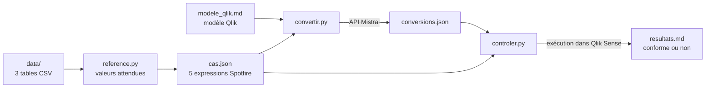

<p align="center">
  
</p>

<h1 align="center">Mistral AI : convertir des expressions Spotfire<br />en expressions Qlik Sense</h1>

<p align="center">
  Un mini-POC en Python : l'API Mistral réécrit 5 expressions d'un tableau de bord Spotfire pour Qlik Sense,
  puis chaque réponse est exécutée dans Qlik et comparée à une valeur recalculée depuis les données.
</p>

<p align="center">
  <a href="README.md"></a>&nbsp;<a href="README.en.md"></a>
</p>

<p align="center">
  <a href="LICENSE"></a>
  
  
  
  
</p>

<p align="center">
  <a href="#démarrage-rapide"><b>Démarrage</b></a>
  &nbsp;·&nbsp; <a href="#architecture">Architecture</a>
  &nbsp;·&nbsp; <a href="#résultats">Résultats</a>
  &nbsp;·&nbsp; <a href="#limites">Limites</a>
</p>

## Démarrage rapide

Prérequis : Python 3.12. Le témoin tourne sans clé ni compte.

```powershell
git clone https://github.com/cnanaj-wq/mistral-ai.git
cd mistral-ai
python reference.py
```

Résultat attendu : 5 lignes `OK`, puis `Les 5 valeurs attendues se retrouvent dans data/.`

Pour lancer la conversion, il faut une clé d'API Mistral :

```powershell
$env:MISTRAL_API_KEY = "ta clé"
python convertir.py
```

Pour contrôler les réponses, il faut l'outil en ligne de commande `qlik`, connecté à un tenant Qlik Sense Cloud où les données sont chargées :

```powershell
python controler.py <identifiant de l'application Qlik>
```

## Choisis ta prochaine étape

| Tu veux… | Va ici |
|---|---|
| Voir les 5 expressions et leurs valeurs attendues | [`cas.json`](cas.json) |
| Lire ce que Mistral reçoit comme contexte | [`modele_qlik.md`](modele_qlik.md) |
| Lire l'appel à l'API | [`convertir.py`](convertir.py) |
| Comprendre comment une réponse est jugée | [`controler.py`](controler.py) |
| Vérifier les valeurs attendues sans Qlik ni Mistral | [`reference.py`](reference.py) |

## Pourquoi ce projet

Migrer un tableau de bord de Spotfire vers Qlik Sense demande de réécrire chaque expression : les deux outils ne filtrent pas les données de la même façon. À la main, c'est long et répétitif.

La question posée ici : un modèle de langage peut-il faire cette réécriture, et peut-on le vérifier sans le croire sur parole ? La réponse se mesure. Une expression convertie n'est acceptée que si, exécutée dans Qlik Sense, elle donne le nombre attendu.

Les données sont celles d'une société fictive, Orvane Distribution, reprises du dépôt [migration-spotfire-qlik-sense](https://github.com/cnanaj-wq/migration-spotfire-qlik-sense).

## Ce qu'il y a dedans

| Élément | Nombre | Où |
|---|---|---|
| Expressions Spotfire à convertir | 5 | [`cas.json`](cas.json) |
| Tables de données (CSV) | 3 | [`data/`](data/) |
| Lignes de données | 10 352 | [`data/`](data/) |
| Scripts Python | 3 | [`convertir.py`](convertir.py), [`controler.py`](controler.py), [`reference.py`](reference.py) |
| Dépendance pour appeler l'API | 0 | bibliothèque standard de Python |

Les cinq cas :

| Cas | Expression Spotfire | Ce qui rend la conversion moins simple |
|---|---|---|
| Chiffre d'affaires cumulé | `Sum([CA Réel])` | la limitation de données doit entrer dans l'expression |
| Taux de marge | `100 * Sum([Marge brute Réel]) / Sum([CA Réel])` | deux agrégations à limiter |
| Écart de chiffre d'affaires au budget | `100 * (Sum([CA Réel]) / Sum([CA Budget]) - 1)` | deux agrégations, des parenthèses |
| EBITDA | `Sum([Réel])` | champs renommés dans Qlik, comparaison `<=` |
| Effets sur la marge | `Sum([Montant]) / 1000` | champs renommés, condition sur un texte |

## Architecture



Trois scripts, trois rôles : `reference.py` calcule ce qu'il faut obtenir, `convertir.py` interroge Mistral, `controler.py` exécute la réponse dans Qlik Sense et tranche.

## Résultats

Le témoin est en place : les 5 expressions de la migration manuelle, exécutées dans Qlik Sense, donnent les 5 valeurs attendues.

| Cas | Valeur attendue | Migration manuelle |
|---|---|---|
| Chiffre d'affaires cumulé | 74 215 646,71 | conforme |
| Taux de marge | 29,4514 % | conforme |
| Écart de chiffre d'affaires au budget | +1,0753 % | conforme |
| EBITDA | 5 311 850,59 | conforme |
| Effets sur la marge | −1 072,4964 k€ | conforme |

La conversion par Mistral n'a pas encore été lancée. Ses résultats seront ajoutés ici, expression par expression, y compris celles qui échouent.

## Plan du dépôt

```
cas.json            les 5 expressions Spotfire, leur limitation et la valeur attendue
modele_qlik.md      la description du modèle Qlik donnée à Mistral
convertir.py        appelle l'API Mistral, écrit conversions.json
controler.py        exécute les expressions dans Qlik Sense, écrit resultats.md
reference.py        recalcule les valeurs attendues depuis data/
data/               3 tables CSV du jeu de données fictif
img/                visuel d'en-tête et son script
```

## Limites

- **Cinq expressions, pas un outil.** Le jeu est trop petit pour conclure sur un tableau de bord entier.
- **Le modèle Qlik est fourni.** Mistral reçoit la liste des champs renommés. Sans elle, il ne peut pas deviner que `[Réel]` est devenu `[CR Réel]`.
- **Un nombre juste ne prouve pas tout.** Le contrôle se fait sans sélection. Une expression peut donner le bon total et mal réagir quand l'utilisateur filtre une région ou un mois.
- **Une réponse peut changer.** La température est à 0, mais un nom de modèle comme `mistral-large-latest` désigne un modèle qui évolue. `conversions.json` garde le nom du modèle qui a répondu.
- **Le contrôle demande Qlik Sense Cloud.** Sans tenant, seul `reference.py` peut être lancé.

## Ce qui est envoyé à Mistral

Pour chaque cas : le nom de la table Spotfire, la limitation de données, l'expression et la description du modèle Qlik. Aucune ligne de données ne part. La clé reste dans une variable d'environnement : elle n'est écrite dans aucun fichier.

## Contribuer · Sécurité · Licence

[Contribuer](CONTRIBUTING.md) · [Sécurité](SECURITY.md) · Licence [MIT](LICENSE)

## Auteur

**Cédric NANA** · Consultant BI & Data · [GitHub](https://github.com/cnanaj-wq)
