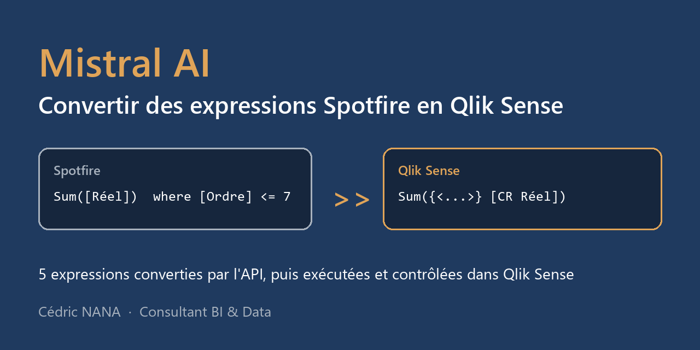
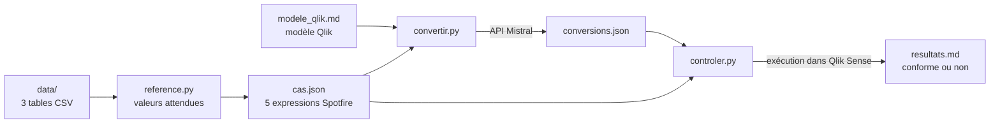
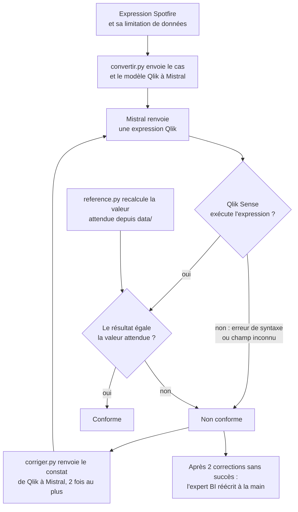

<p align="center">
  
</p>

<h1 align="center">Mistral AI : convertir des expressions Spotfire<br />en expressions Qlik Sense</h1>

<p align="center">
  Un mini-POC en Python : l'API Mistral réécrit 5 expressions d'un tableau de bord Spotfire pour Qlik Sense,
  puis chaque réponse est exécutée dans Qlik et comparée à une valeur recalculée depuis les données.
</p>

<p align="center">
  <a href="README.md"></a>&nbsp;<a href="README.en.md"></a>
</p>

<p align="center">
  <a href="LICENSE"></a>
  
  
  
  
</p>

<p align="center">
  <a href="#démarrage-rapide"><b>Démarrage</b></a>
  &nbsp;·&nbsp; <a href="#architecture">Architecture</a>
  &nbsp;·&nbsp; <a href="#logigramme">Logigramme</a>
  &nbsp;·&nbsp; <a href="#résultats">Résultats</a>
  &nbsp;·&nbsp; <a href="#limites">Limites</a>
</p>

## Démarrage rapide

Prérequis : Python 3.12. Le témoin tourne sans clé ni compte.

```powershell
git clone https://github.com/cnanaj-wq/mistral-ai.git
cd mistral-ai
python reference.py
```

Résultat attendu : 5 lignes `OK`, puis `Les 5 valeurs attendues se retrouvent dans data/.`

Pour lancer la conversion, il faut une clé d'API Mistral :

```powershell
$env:MISTRAL_API_KEY = "ta clé"
python convertir.py
```

Pour contrôler les réponses, il faut l'outil en ligne de commande `qlik`, connecté à un tenant Qlik Sense Cloud où les données sont chargées :

```powershell
python controler.py <identifiant de l'application Qlik>
```

## Choisis ta prochaine étape

| Tu veux… | Va ici |
|---|---|
| Voir les 5 expressions et leurs valeurs attendues | [`cas.json`](cas.json) |
| Lire ce que Mistral reçoit comme contexte | [`modele_qlik.md`](modele_qlik.md) |
| Lire l'appel à l'API | [`convertir.py`](convertir.py) |
| Comprendre comment une réponse est jugée | [`controler.py`](controler.py) |
| Voir comment l'erreur de Qlik est renvoyée à Mistral | [`corriger.py`](corriger.py) |
| Vérifier les valeurs attendues sans Qlik ni Mistral | [`reference.py`](reference.py) |

## Pourquoi ce projet

Migrer un tableau de bord de Spotfire vers Qlik Sense demande de réécrire chaque expression : les deux outils ne filtrent pas les données de la même façon. À la main, c'est long et répétitif.

La question posée ici : un modèle de langage peut-il faire cette réécriture, et peut-on le vérifier sans le croire sur parole ? La réponse se mesure. Une expression convertie n'est acceptée que si, exécutée dans Qlik Sense, elle donne le nombre attendu.

Les données sont celles d'une société fictive, Orvane Distribution, reprises du dépôt [migration-spotfire-qlik-sense](https://github.com/cnanaj-wq/migration-spotfire-qlik-sense).

## Ce qu'il y a dedans

| Élément | Nombre | Où |
|---|---|---|
| Expressions Spotfire à convertir | 5 | [`cas.json`](cas.json) |
| Tables de données (CSV) | 3 | [`data/`](data/) |
| Lignes de données | 10 352 | [`data/`](data/) |
| Scripts Python | 4 | [`convertir.py`](convertir.py), [`controler.py`](controler.py), [`corriger.py`](corriger.py), [`reference.py`](reference.py) |
| Dépendance pour appeler l'API | 0 | bibliothèque standard de Python |

Les cinq cas :

| Cas | Expression Spotfire | Ce qui rend la conversion moins simple |
|---|---|---|
| Chiffre d'affaires cumulé | `Sum([CA Réel])` | la limitation de données doit entrer dans l'expression |
| Taux de marge | `100 * Sum([Marge brute Réel]) / Sum([CA Réel])` | deux agrégations à limiter |
| Écart de chiffre d'affaires au budget | `100 * (Sum([CA Réel]) / Sum([CA Budget]) - 1)` | deux agrégations, des parenthèses |
| EBITDA | `Sum([Réel])` | champs renommés dans Qlik, comparaison `<=` |
| Effets sur la marge | `Sum([Montant]) / 1000` | champs renommés, condition sur un texte |

## Architecture



Quatre scripts, quatre rôles : `reference.py` calcule ce qu'il faut obtenir, `convertir.py` interroge Mistral, `controler.py` exécute la réponse dans Qlik Sense et tranche, `corriger.py` renvoie à Mistral ce que Qlik a constaté.

## Logigramme

Le parcours d'une expression, de Spotfire jusqu'au verdict :



## Résultats

Essai du 26/11/2026, modèle `mistral-medium-latest`, une seule demande par expression, sans correction.

| Cas | Valeur attendue | Migration manuelle | Conversion par Mistral |
|---|---|---|---|
| Chiffre d'affaires cumulé | 74 215 646,71 | conforme | non conforme |
| Taux de marge | 29,4514 % | conforme | non conforme |
| Écart de chiffre d'affaires au budget | +1,0753 % | conforme | non conforme |
| EBITDA | 5 311 850,59 | conforme | non conforme |
| Effets sur la marge | −1 072,4964 k€ | conforme | conforme |
| **Total** | | **5 sur 5** | **1 sur 5** |

Les quatre échecs ont la même cause, une règle de syntaxe de Qlik Sense. Mistral a écrit :

```
Sum({<[Exercice]={2026}, [Mois]={<=10}>} [CA Réel])
```

Dans une analyse d'ensembles, une comparaison est une recherche et s'écrit entre guillemets : `[Mois]={"<=10"}`. Sans eux, Qlik Sense ne renvoie aucune valeur.

Ce que Mistral a réussi dans les cinq cas : faire entrer la limitation Spotfire dans l'expression, et retrouver les champs renommés (`[CR Réel]`, `[Ordre rubrique]`, `[Type de poste]`, `[Écart de marge]`). Le seul cas conforme est celui qui ne contient aucune comparaison.

Ce que l'essai montre : la conversion ressemble à du Qlik correct et se lit bien, mais quatre fois sur cinq elle ne calcule rien. Sans exécution dans Qlik Sense, l'erreur passait inaperçue. Les réponses brutes sont dans [`conversions.json`](conversions.json), le détail du contrôle dans [`resultats.md`](resultats.md).

### Second essai : Mistral reçoit le constat de Qlik Sense

[`corriger.py`](corriger.py) exécute chaque expression dans Qlik Sense. Si elle n'est pas conforme, Mistral reçoit sa propre réponse et ce que Qlik a répondu, sans la valeur attendue ni indication sur la cause. Deux corrections au plus par cas.

| Cas | Premier essai | Après retour de Qlik Sense | Demandes à Mistral |
|---|---|---|---|
| Chiffre d'affaires cumulé | non conforme | conforme | 2 |
| Taux de marge | non conforme | conforme | 3 |
| Écart de chiffre d'affaires au budget | non conforme | conforme | 2 |
| EBITDA | non conforme | conforme | 3 |
| Effets sur la marge | conforme | conforme | 1 |
| **Total** | **1 sur 5** | **5 sur 5** | **11** |

Mistral n'a pas trouvé la règle des guillemets. Il l'a contournée en listant les valeurs une à une :

```
Sum({<[Exercice]={2026}, [Mois]={1,2,3,4,5,6,7,8,9,10}>} [CA Réel])
```

Le nombre est juste, l'écriture est plus lourde que celle de la migration manuelle (`[Mois clos]={1}`), et elle devra être reprise à la main si un mois de plus est clôturé. Deux cas ont demandé deux corrections : la première tentative ajoutait des espaces ou écrivait `{1..10}`, que Qlik Sense refuse aussi.

### Essai 1, puis essai 2 : ce que Mistral a écrit et ce que Qlik a répondu

Chaque ligne est une réponse de Mistral, telle qu'elle est sortie, suivie de ce que Qlik Sense en a fait. Le message renvoyé à Mistral après un échec est toujours le même : « J'ai exécuté ton expression dans Qlik Sense : Qlik Sense répond : Qlik ne renvoie aucune valeur (expression invalide). Corrige l'expression et réponds dans le même format JSON. »

**EBITDA**

Spotfire : `Sum([Réel])`, limitée par `[Exercice] = 2026 and [Mois] <= 10 and [Ordre] <= 7`

| Essai | Réponse de Mistral | Retour de Qlik Sense |
|---|---|---|
| 1 | `Sum({<[Exercice]={2026}, [Mois]={<=10}, [Ordre rubrique]={<=7}>} [CR Réel])` | aucune valeur renvoyée |
| 2 | `Sum({<[Exercice]={2026}, [Mois]={1..10}, [Ordre rubrique]={1..7}>} [CR Réel])` | aucune valeur renvoyée |
| 3 | `Sum({<[Exercice]={2026}, [Mois]={1,2,3,4,5,6,7,8,9,10}, [Ordre rubrique]={1,2,3,4,5,6,7}>} [CR Réel])` | conforme : 5311850.5900 |

<details>
<summary>Voir les quatre autres cas</summary>

**Chiffre d'affaires cumulé**

Spotfire : `Sum([CA Réel])`, limitée par `[Exercice] = 2026 and [Mois] <= 10`

| Essai | Réponse de Mistral | Retour de Qlik Sense |
|---|---|---|
| 1 | `Sum({<[Exercice]={2026}, [Mois]={<=10}>} [CA Réel])` | aucune valeur renvoyée |
| 2 | `Sum({<[Exercice]={2026}, [Mois]={1,2,3,4,5,6,7,8,9,10}>} [CA Réel])` | conforme : 74215646.7100 |

**Taux de marge**

Spotfire : `100 * Sum([Marge brute Réel]) / Sum([CA Réel])`, limitée par `[Exercice] = 2026 and [Mois] <= 10`

| Essai | Réponse de Mistral | Retour de Qlik Sense |
|---|---|---|
| 1 | `100 * Sum({<[Exercice]={2026}, [Mois]={<=10}>} [Marge brute Réel]) / Sum({<[Exercice]={2026}, [Mois]={<=10}>} [CA Réel])` | aucune valeur renvoyée |
| 2 | `100 * Sum({<[Exercice] = {2026}, [Mois] = {<=10}>} [Marge brute Réel]) / Sum({<[Exercice] = {2026}, [Mois] = {<=10}>} [CA Réel])` | aucune valeur renvoyée |
| 3 | `100 * Sum({<[Exercice]={2026}, [Mois]={1,2,3,4,5,6,7,8,9,10}>} [Marge brute Réel]) / Sum({<[Exercice]={2026}, [Mois]={1,2,3,4,5,6,7,8,9,10}>} [CA Réel])` | conforme : 29.4514 |

**Écart de chiffre d'affaires au budget**

Spotfire : `100 * (Sum([CA Réel]) / Sum([CA Budget]) - 1)`, limitée par `[Exercice] = 2026 and [Mois] <= 10`

| Essai | Réponse de Mistral | Retour de Qlik Sense |
|---|---|---|
| 1 | `100 * (Sum({<[Exercice]={2026}, [Mois]={<=10}>} [CA Réel]) / Sum({<[Exercice]={2026}, [Mois]={<=10}>} [CA Budget]) - 1)` | aucune valeur renvoyée |
| 2 | `100 * (Sum({<[Exercice]={2026}, [Mois]={1,2,3,4,5,6,7,8,9,10}>} [CA Réel]) / Sum({<[Exercice]={2026}, [Mois]={1,2,3,4,5,6,7,8,9,10}>} [CA Budget]) - 1)` | conforme : 1.0753 |

**Effets sur la marge**

Spotfire : `Sum([Montant]) / 1000`, limitée par `[Exercice] = 2026 and [Type] = "Effet"`

| Essai | Réponse de Mistral | Retour de Qlik Sense |
|---|---|---|
| 1 | `Sum({<[Exercice]={2026}, [Type de poste]={'Effet'}>} [Écart de marge]) / 1000` | conforme : -1072.4964 |

</details>

Ce que le second essai montre : c'est la boucle « convertir, exécuter, corriger » qui fait passer de 1 à 5 sur 5, pas la conversion seule. Les essais successifs sont dans [`corrections.json`](corrections.json).

## Plan du dépôt

```
cas.json            les 5 expressions Spotfire, leur limitation et la valeur attendue
modele_qlik.md      la description du modèle Qlik donnée à Mistral
convertir.py        appelle l'API Mistral, écrit conversions.json
controler.py        exécute les expressions dans Qlik Sense, écrit resultats.md
corriger.py         renvoie le constat de Qlik à Mistral, écrit corrections.json
reference.py        recalcule les valeurs attendues depuis data/
data/               3 tables CSV du jeu de données fictif
img/                visuel d'en-tête et son script
```

## Limites

- **Un seul passage, un seul modèle.** Chaque essai a été lancé une fois, avec `mistral-medium-latest`. Le résultat ne dit pas ce que donnerait un autre modèle ou une consigne plus précise.
- **La boucle a besoin d'une valeur attendue.** Elle s'arrête quand le nombre est le bon. Sur un vrai tableau de bord, il faut d'abord avoir ce nombre, lu dans Spotfire ou recalculé depuis les données.
- **Cinq expressions, pas un outil.** Le jeu est trop petit pour conclure sur un tableau de bord entier.
- **Le modèle Qlik est fourni.** Mistral reçoit la liste des champs renommés. Sans elle, il ne peut pas deviner que `[Réel]` est devenu `[CR Réel]`.
- **Un nombre juste ne prouve pas tout.** Le contrôle se fait sans sélection. Une expression peut donner le bon total et mal réagir quand l'utilisateur filtre une région ou un mois.
- **Une réponse peut changer.** La température est à 0, mais un nom de modèle comme `mistral-medium-latest` désigne un modèle qui évolue. `conversions.json` garde le nom du modèle qui a répondu.
- **Le contrôle demande Qlik Sense Cloud.** Sans tenant, seul `reference.py` peut être lancé.

## Ce qui est envoyé à Mistral

Pour chaque cas : le nom de la table Spotfire, la limitation de données, l'expression et la description du modèle Qlik. Aucune ligne de données ne part. La clé reste dans une variable d'environnement : elle n'est écrite dans aucun fichier.

## Contribuer · Sécurité · Licence

[Contribuer](CONTRIBUTING.md) · [Sécurité](SECURITY.md) · Licence [MIT](LICENSE)

## Auteur

**Cédric NANA** · Consultant BI & Data · [GitHub](https://github.com/cnanaj-wq)
